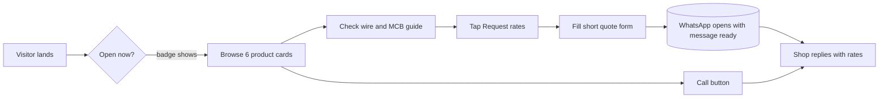

[README.md](https://github.com/user-attachments/files/33647775/README.md)
<div align="center">

```text
   ┌─────────────────────────────────────────────┐
   │   ⚡  ELECTRICAL SHOP WEBSITE  ·  v1.0      │
   │   SINGLE-PAGE  ·  ZERO DEPENDENCIES         │
   │   INPUT: 1 × HTML FILE   OUTPUT: CUSTOMERS  │
   └─────────────────────────────────────────────┘
```

# ⚡ Sri Lakshmi Electricals

**A fast, professional website for a local electrical shop. Customers browse products, check a wire guide and send a quotation request straight to your WhatsApp.**


[**▶ Live Preview**](https://claude.ai/artifact/K6GE5rGLXuQqnoiYodXHiS) · [**Report an Issue**](../../issues)

</div>

---

## 📋 Datasheet

| Parameter | Value |
|---|---|
| **Product** | One-page website for an electrical shop |
| **Pages** | 1 (7 sections) |
| **Files** | `index.html` |
| **Dependencies** | None. Only Google Fonts for typography |
| **Lead channel** | WhatsApp click-to-chat and phone call |
| **Themes** | Light and dark, follows the visitor's device |
| **Layout** | Responsive, mobile bottom call bar |
| **Setup time** | About 10 minutes |

## 🔌 Circuit Diagram: How a Customer Flows Through



## 🧩 Components on the Page

| # | Section | Purpose |
|:-:|---|---|
| 1 | **Top strip and header** | Trust message, shop name, call button, Get Quote |
| 2 | **Hero** | Headline, three action buttons, live Open/Closed badge, four trust boxes |
| 3 | **Info bar** | Address, proprietor, phone, timings |
| 4 | **Product catalogue** | Six cards with specs, features and a "Request rates" button |
| 5 | **Wire and MCB guide** | Quick reference table that builds trust and saves questions |
| 6 | **Why us and who we serve** | Four reasons to choose the shop and six customer types |
| 7 | **Quote form and contact** | WhatsApp quote form, address, email, areas served, Maps link |

## 🛒 Product Bill of Materials

| Card | Covers |
|---|---|
| **Wires and Cables** | FR/FRLS copper wire, flexible cable, earthing |
| **Switches and Sockets** | Modular plates, USB sockets, dimmers, regulators |
| **LED Lighting** | Bulbs, battens, panels, flood and strip lights |
| **Fans and Coolers** | Ceiling, BLDC, exhaust and pedestal fans |
| **MCBs and DBs** | MCB, RCCB, distribution boards, changeovers |
| **Wiring and Repair Service** | Installation, fitting, fault finding |

## 🧮 Built-In Wire Guide

| Copper wire | Typical MCB | Common use |
|---|:-:|---|
| 1.5 sq mm | 6 A | Lights and fans |
| 2.5 sq mm | 16 A | Power sockets, fridge, small AC |
| 4 sq mm | 25 A | Geyser, larger AC, kitchen |
| 6 sq mm | 32 A | Sub-mains and heavy loads |

> ⚠️ This chart is indicative only. Confirm with a qualified electrician and follow local electrical codes before wiring.

## ⚙️ Wire It Up: Set Up in 3 Steps

**Step 1: Put in your shop details.** Everything lives in one block at the top of the script:

```js
const CFG = {
  name:  "Your Shop Name",
  tag:   "Wires • Lights • Fans • Switchgear",
  owner: "Owner Name",
  phone: "+91 98765 43210",
  wa:    "919876543210",        // country code + number, no + or spaces
  email: "you@example.com",
  addr:  "Shop address, Town, State",
  areas: ["Your Town", "Nearby Villages"],
  hours: { 0:[9,14], 1:[9,21], 2:[9,21], 3:[9,21], 4:[9,21], 5:[9,21], 6:[9,21] }
};
```

`hours` uses the day number (0 = Sunday) and `[opening hour, closing hour]` in 24-hour format. It powers the live Open/Closed badge.

**Step 2: Edit your products.** Each entry in the `PR` array is one card:

```js
["Title", "Tag", "Spec line", "Description", ["Feature 1", "Feature 2"], "Best for text"]
```

**Step 3: Change the look.** Colours are variables at the top of the stylesheet:

```css
--navy: #0b1b3a;   /* header, hero, footer */
--ac:   #ffb400;   /* accent yellow */
```

## 🚀 Go Live Free

| Platform | How |
|---|---|
| 🐙 **GitHub Pages** | Settings → Pages → Deploy from `main` |
| 🟢 **Netlify** | Drag and drop the folder |
| ▲ **Vercel** | Import the repository |

Point your own domain (for example `yourshop.in`) at the host for a more professional address.

## ✅ Pre-Launch Checklist

- [ ] Shop name, phone, WhatsApp number and email updated
- [ ] Address and Google Maps link tested
- [ ] Timings set, and the Open/Closed badge checked
- [ ] Product cards match what you really stock
- [ ] Wire guide reviewed by an electrician
- [ ] Quote form tested: it opens WhatsApp with the message
- [ ] Opened on a real phone
- [ ] Shop listed on Google Business Profile with the website link

## 🛠️ Fault Finding

| Symptom | Likely cause | Fix |
|---|---|---|
| WhatsApp opens with no message | Wrong `wa` format | Use country code and number only, such as `919876543210` |
| "Closed now" during shop hours | `hours` values wrong | Check the 24-hour numbers per day |
| Mobile number rejected in form | Not a valid Indian mobile | Needs 10 digits starting with 6 to 9 |
| Fonts look plain | Google Fonts blocked | Fallback fonts still work. Check your connection |

## 🗺️ Roadmap

- [x] Live Open/Closed badge
- [x] WhatsApp quote form
- [x] Wire and MCB size guide
- [x] Light and dark themes
- [ ] Product photos and price list
- [ ] Customer reviews section
- [ ] Brand logos strip
- [ ] Telugu / Tamil / Hindi language switch
- [ ] Google Maps embed

## 🤝 Contributing

Fork the repo, create a branch, make your change and open a pull request.

## 📄 License

Released under the MIT License.

<div align="center">

**Built to turn walk-by searches into WhatsApp enquiries.** ⚡

</div>
